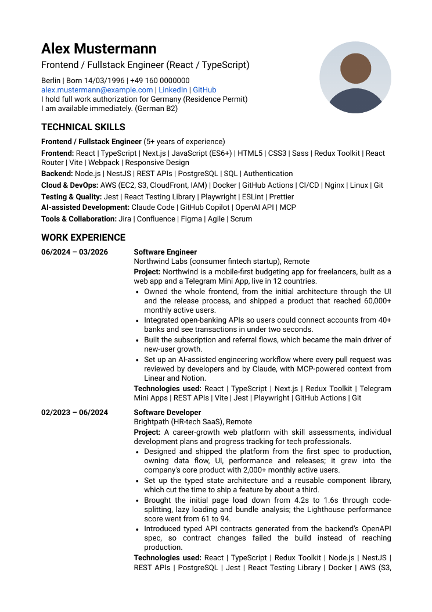

# autopilot-jobsearch

[](https://github.com/madvil2/autopilot-jobsearch/actions/workflows/ci.yml)

The skills I use to run my job search on autopilot with Claude Code. Not a demo: this is the setup that applies for me twice a day, right now.

A job search is a numbers game, and by hand you lose it. The fresh postings go out at nine, the first slot goes to whoever answers first, the follow-up never gets sent, and the tracker is a spreadsheet nobody updates. So I gave the whole thing to an agent. Twice a day it reads my mail and recruiter messages, answers them, checks every board I care about, applies, books the earliest interview slot, logs everything to a tracker and my calendar, and leaves me a short report. Around that it keeps my profile, a CV that renders to PDF, cover letters, interview prep and debriefs, all as markdown in one folder.

This repository is that setup with my data removed, packaged as a Claude Code plugin. Install it, run `/autopilot-jobsearch:init` in an empty folder, and it runs yours.

## Why you can trust it

I did not make this up over a weekend.

- **It is live.** Between late August and early October 2026 the sweep ran 93 times on my account: 637 applications, 18 interviews booked, 199 rejections filed with a reason, follow-ups sent, every call logged. The funnel is public: [my JobCubby page](https://jobcubby.com/s/madvil2) shows the running counts, the conversion from applied to screening to interview, and the milestone log, updated by the sweep itself. The skills in this repo are the method as it stands after reading all 93 transcripts and fixing what broke, what cost money, and what got applications lost.
- **The method is researched, not guessed.** I went through everything I could find on how hiring works in the markets I apply in, did several courses, worked through a career coach's full course, and took the best from all of it: what held up in practice stayed, the rest went. The CV template, the bullet shape, the intro script, the interview method and the offer checklist all come from that, in my own words.
- **It is checked against people who hire.** I talked to recruiters and HR people on both sides of the table, asked friends who run hiring and friends who just finished their own search, and changed the rules whenever they told me something I did not know. Several rules in here exist because one recruiter told me how a specific thing looked from their side.
- **I have been on the market long enough to know what matters.** Years of frontend and fullstack work, over five of them in React and TypeScript, searches in Germany and Ukraine on their own boards and in their own languages, remote and onsite, startups and corporates. The market notes in `docs/markets/` are what I learned the hard way.
- **It does the work, from your facts.** It applies, answers recruiters, names your salary figure, books the earliest slot, sends follow-ups and email applications with your CV, and logs every step, without waiting for you. Every fact it writes comes from your profile and your approved CV, and everything it sends in your name is quoted in full in the report.

Hack around with it. Change the rules to yours. The method is mine; the search is yours.

## Installation (two minutes)

It is a Claude Code plugin. In any Claude Code session:

```
/plugin install autopilot-jobsearch --marketplace madvil2/autopilot-jobsearch
```

Then make a folder for your search and start there:

```bash
mkdir my-job-search && cd my-job-search
claude               # then: /autopilot-jobsearch:init
```

`/autopilot-jobsearch:init` creates your workspace files, sets up the tool servers for that folder, checks them, and opens each job board once so you can log in. Then drop the CV you already have into `cv/old/`, run `/autopilot-jobsearch:profile` and `/autopilot-jobsearch:cv` (they read that file and ask only for what it does not say), fill `sources.md` with your boards, run `/autopilot-jobsearch:sweep` once by hand, and schedule it twice a day (`docs/scheduling.md`). Everything the skills write stays in that folder; the plugin updates with `claude plugin update autopilot-jobsearch`.

To change the method itself, clone instead: the clone is both the plugin source and a workspace, and the skills load as `/init`, `/sweep` and so on when you run `claude` inside it. To try your edits as the plugin, start Claude Code with `claude --plugin-dir /path/to/your/clone`; that copy replaces the installed one for the session. Do not register the clone itself as a local marketplace: the plugin would then also load the clone's workspace `.mcp.json` into every session.

```bash
git clone https://github.com/madvil2/autopilot-jobsearch.git
cd autopilot-jobsearch
npm install          # the PDF renderer's dependency
claude               # then: /init
```

Requirements: Node 20+, Claude Code, a JobCubby account, and for each of three choices made once in `/init` one path: reading mail through a Gmail connector (or any mail MCP) or through Mail.app on macOS or classic Outlook on Windows; sending email applications through that mail app or SMTP with an app password; the calendar through Calendar.app on macOS or classic Outlook on Windows, or through a Google Calendar connector (or any calendar MCP). Optional: poppler for PDF previews (`brew install poppler`), OBS and `stable-ts` for recording and transcribing interviews (`docs/recording-and-transcription.md`).

## The skills

Installed as a plugin they are `/autopilot-jobsearch:<name>`; inside a clone the short names below also work.

Setting up:

- **`/init`**: workspace files from templates, tool checks, one-time board logins, the mail and calendar paths, optional private history of your data.
- **`/profile`**: reads your existing CV, fills `profile.md` from it, then asks only for what is missing: every fact forms ask, your stack order, how you present per market, salary figures, your intro script.
- **`/cv`**: converts your CV into the template (or builds one from scratch), fixes every bullet with you until it carries a result, renders an A4 PDF, uploads it to the tracker.
- **`/profiles`**: keeps LinkedIn and every other board profile consistent with the CV: headline, About, experience, keywords, photo.

Every day:

- **`/sweep`**: the twice-daily pass: mail, messages, follow-ups, tracker matches, every board, applications, bookings, report.
- **`/cover-letter`**: a three-paragraph letter for one posting, rendered next to the CV.
- **`/interview-prep`**: researches the company and writes a prep file with your intro, the why-company answer, likely questions and your questions.
- **`/debrief`**: transcribes the OBS recording with stable-ts, grades the call against the method's Rubric, pulls out every fact they revealed, closes the loop in the tracker.

When it matters:

- **`/coach`**: my interview method: intro, why-company frames, the three-step method for technical questions, the rules, salary, closing (`docs/interview-method.md`); `/coach mock` to practice.
- **`/outreach`**: for postings worth more than a form: finds the hiring manager and people who can refer you, writes the call script and the messages.
- **`/stack-radar`**: counts which technologies the postings you applied to ask for, compares with your CV, proposes tags and a learning plan.
- **`/offer`**: when an offer arrives: the reply that keeps it warm, the contract checklist, the package evaluation, the questions to ask. You decide; it prepares.

Example output in `examples/`: a fictional engineer's profile, CV ([markdown](examples/cv/base.md), [PDF](examples/cv/Alex_Mustermann_CV.pdf)), a cover letter, a prep file and a sweep report.



*The first page of [the example CV](examples/cv/Alex_Mustermann_CV.pdf), rendered by `scripts/render.mjs` from [base.md](examples/cv/base.md).*

## How it works

- **A folder is the workspace.** The skills come from the plugin; your files (`profile.md`, `rules.md`, `sources.md`, `cv/`, `cover-letters/`, `prep/`, `photos/`, `documents/`, `recordings/`, `transcripts/`, `reports/`) live in whatever folder you run Claude Code in. In a clone the same files are gitignored, so `git pull` updates the method and never your data.
- **Your data gets a history, privately (optional).** `/init` asks one question and runs the plugin's `scripts/data init --github`: a second git (`.data.git/`, ignored by the method repo) tracks only your personal paths in place, a private GitHub repo is created for it through `gh`, and from then on every skill that writes a CV, a prep file or a report saves a snapshot. You never run git for your data; `scripts/data log` and `scripts/data diff` are there when you want to look back. Any other private remote works with `scripts/data remote <url>`.
- **Tracker: JobCubby.** I use [JobCubby](https://jobcubby.com/r/kostiantyn-53zr), a friend's platform: a pipeline with statuses and timelines, interviews, contacts, résumé versions, a job index with AI matches against your profile, and an MCP endpoint with OAuth, so the agent reads and writes it directly. `/init` writes a `.mcp.json` into your workspace that points at it (and at the Playwright MCP), so both servers run only in that folder. The free plan carries a real search: 10,000 applications per account including the archive, 200 new a day, 30 a minute. That link is my referral. For a different tracker, fork and replace the JobCubby calls; the contract is small (create and update applications, statuses, events, interviews, résumés).
- **Browser: Playwright MCP.** In the same `.mcp.json`. It keeps its own browser profile, so you log in to each board once and the sweep runs on your sessions after that. The agent never types a password.
- **Calendar.** `CALENDAR_VIA` in `.calendar.env`, chosen in `/init`: `app` writes interviews and deadlines to the calendar app on this machine through `scripts/calendar.mjs` (Calendar.app on macOS, classic Outlook on Windows, that path untested), into the calendar named there, so your Google account's calendar syncs them to Google; `connector` uses the claude.ai Google Calendar connector or any calendar MCP.
- **Mail.** `MAIL_READ` in `.mail.env`, chosen in `/init`: `connector` reads and replies through the claude.ai Gmail connector or any mail MCP, addressed by what it does, not by tool name; `app` reads and replies through `scripts/mail.mjs` and the mail app on this machine. Applications by email with the CV attached go out through `scripts/mail.mjs` by `MAIL_TRANSPORT`: Mail.app on macOS, classic Outlook on Windows or SMTP with an app password.
- **PDFs.** `scripts/render.mjs` turns `cv/*.md` and `cover-letters/*.md` into A4 PDFs through Chromium, with the layout in `templates/cv.html` and `templates/cover-letter.html`: Roboto, single column, date column on the left, photo top right, no tables, so parsers and humans both read it. Edit the HTML to change the design; the markdown contract stays.

## The daily rhythm

1. Morning sweep at 09:12. I read the report with coffee: what needs me (money, a question the profile could not answer, a blocked login), what was replied, who said no, where it applied.
2. Interviews get a prep file the day before. I read it, open their product, find one detail, rehearse the intro aloud, and close the file before the call.
3. Every call is recorded. `/debrief` turns it into facts and three lines of feedback, and the tracker moves on.
4. Evening sweep at 19:12.
5. Once a month, `/stack-radar`: what the market asks for that my CV does not say yet, and what to learn.

## What it will not do

- Type a password, solve a bot check or commit you to a contract form, a visa or a relocation. Those few steps wait in the report for you; everything else runs on its own.
- Apply to anything. It applies when the stack matches your profile and skips on your hard filters; it does not pad your numbers with postings you would not take.
- Replace a lawyer. The contract checklist in `/offer` is a reading aid; for a contract in a new jurisdiction, get a human.

## Layout

```
.claude-plugin/      plugin manifest and the marketplace entry (the repo installs as a plugin)
.claude/skills/      the twelve skills (loaded by the plugin, and as project skills inside a clone)
templates/           blank workspace files with guidance, mcp.json, CV and letter HTML, section labels per language
scripts/             render.mjs (md to PDF), test.mjs, lint-skills.mjs, data (private history)
routines/sweep.md    the scheduled-task prompt (one paragraph: cd into the workspace, run the sweep skill)
docs/                platform notes, scheduling, recording and transcription, market notes (Germany first)
examples/            a fictional person's complete set
fonts/               Roboto (Apache 2.0)
GLOSSARY.md          the vocabulary
```

`npm test` renders the examples and checks the PDFs. `npm run lint` checks the skills and that every image the README embeds is committed. The CV preview above is `pdftoppm -png -r 90 -f 1 -l 1 -singlefile examples/cv/Alex_Mustermann_CV.pdf examples/cv/Alex_Mustermann_CV-preview` (90 dpi keeps it under the plugin scanner's 256 KB limit); rerun it when the example CV changes.

## License

MIT. Roboto is Apache 2.0.
